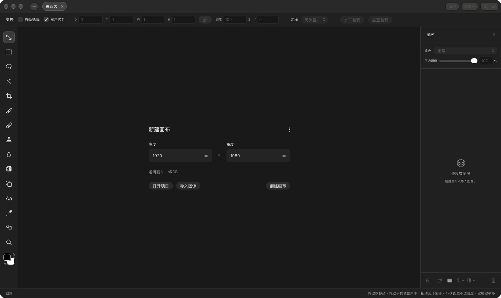

# Compositor 中文版（汉化版）

> **免责声明 / Disclaimer**：本项目为非官方汉化版，与上游作者无关。汉化版的问题请提到[本仓库的 Issues](../../issues)，不要去打扰上游。
>
> This is an **unofficial** Simplified Chinese localization of [robbietilton/Compositor](https://github.com/robbietilton/Compositor), not affiliated with the upstream author. The upstream project is developed by Robbie Tilton and licensed under MIT (see LICENSE).
>
> **下载安装**：见 [Releases](../../releases) 页面的 DMG，提供两个版本：
>
> | 版本 | 文件 | 说明 |
> | --- | --- | --- |
> | 纯汉化版 | `Compositor-1.5.10-CN-L10n.dmg` | 只翻译界面，功能与上游 v1.5.10 完全一致，适合想要「原版体验 + 中文」的用户 |
> | 个人修改版 | `Compositor-1.5.10-CN-Mod.dmg` | 汉化 + 下方「本分支新增功能」的全部内容（印刷尺寸、多格式导出、移除工具等） |
>
> 因为安装包没有 Apple 开发者签名/公证，首次打开需在「系统设置 › 隐私与安全性」里选择「仍要打开」。
>
> 本分支的差异：
> - 全部界面文字汉化（菜单、面板、弹窗、撤销动作名、PSD 导入报告等，术语对齐 Photoshop 中文版）
> - 项目文件（.comp）与 PSD 的存储格式保持英文不变，与上游完全互通
> - 移除了 Sparkle 自动更新（避免更新回英文版），改为启动页轻量更新提醒（每天最多一次只读查询本仓库 Releases，有新中文版时提示，不自动下载）
>
> 已同步上游 **v1.5.4 – v1.5.10**（2026-10）：画笔数位板压感、PDF 导入（每页一个图层，个人修改版此前自带的 PDF 导入已改用上游官方实现）、虚线/点线、字体列表可搜索、新滤镜「RGB 分离」「镜头效果」（变形光斑/星芒/薄雾/棱镜/焦外光斑）「锐化」、暗角/色调对比度/渐进模糊/泛光等可作调整图层且大幅提速、动图 GIF（导入后画布下方有帧时间轴，可播放/编辑/调速/导出动画 GIF）、「导出为」新增通道打包（RGBA 通道贴图）、图层面板可按名称搜索和按类型过滤、图层对齐与分布、裁剪支持自定义比例和 2.39:1、PSD 画板各自开标签页、非拉丁键盘布局快捷键可用、窗口太矮时工具栏变双列、图像/画布大小保持缩放。
>
> <details><summary>v1.5.3 同步内容</summary>
>
> Camera Raw 预览 GPU 加速（拖滑块保持全分辨率）、直方图/示波器更快、矩形新增「平滑圆角」（60% squircle，与 Figma 的 iOS 设置一致）、形状控件精简（填充色板移到最前）、图层面板中键拖动滚动、缩放光标方向即时更新。
>
> </details>
>
> <details><summary>v1.5.2 同步内容</summary>
>
> Camera Raw「阴影」对齐 Photoshop 的暗部提亮、RAW 导入可直接进入 Camera Raw 滤镜、Camera Raw 每个分区可单独重置、键盘快捷键可清空/可为 CMYK 校样与色域警告设键/Delete 键可改/自定义快捷键更新后保留。
>
> </details>
>
> <details><summary>v1.5.1 / v1.5 同步内容</summary>
>
> 16 位图层（16-bit PNG/TIFF/HEIF/RAW 保留全部精度，右键菜单可在 8/16 位间转换）、HDR（可打开 EXR/.hdr 并保留高光）、CMYK 支持（显示 › CMYK 校样颜色与色域警告、JPEG/TIFF/PDF 可按 CMYK 导出、可打开 CMYK 的 PSD/JPEG/TIFF）、新滤镜「渐进模糊」（在画布上拖两个点）、导出 EXR 和 16 位 PNG、新建画布页可直接粘贴图片建画布、图片拖到标签栏任意位置即可开新项目、拖入的图层自动决定新项目的画布尺寸、新图标。
>
> </details>
>
> <details><summary>v1.4.10 / v1.4.9 同步内容</summary>
>
> 污点修复画笔和内容识别填充重写（多尺度 PatchMatch，边缘和纹理自然延续）、支持把整个文件夹拖入导入为图层、高斯模糊新增「保留透明」、RAW 显影新增降噪/镜头校正/高光恢复、支持佳能/索尼/富士相机的 HEIF 照片（.hif/.heif）、支持导入 WebP 图像、Camera Raw 滤镜全面重写对齐 Photoshop（白平衡/混色器/曲线/分级等）且预览提速最多 20 倍、图层效果和实时文字在调整画布/图像大小后保留、⌘ 或 ⌃ 加中键拖动缩放、新图标。
>
> </details>
>
> <details><summary>v1.4.8 同步内容</summary>
>
> 新增「文件 › 导出为…」（⇧⌥⌘W，PNG/JPEG/PDF，尺寸可调、实时预览，个人修改版在此基础上扩展了更多格式）、扫描线独立成滤镜（位移/平滑度/阈值/色彩分离/黑场等新参数）、导航器小地图（显示 › 导航器，300% 及以上缩放时出现）、在画布上选中的图层会在图层面板中自动显示、Camera Raw 的阴影/高光保持色调顺序。
>
> </details>
>
> <details><summary>v1.4.7 同步内容</summary>
>
> 「滤镜 › 上次滤镜」快捷键改为 ⌃⌘F（与 Photoshop 一致，⌘F 留给命令面板）、仅画布模式 F 键在菜单中显示且 Esc 可退出、窗口太窄时顶部工具条可横向滚动、抓手工具整段平移手型保持握住、图层面板底部按钮样式与重命名输入框改进、未保存对话框的「Don't Save」标记为红色破坏性按钮。
>
> </details>
>
> <details><summary>v1.4.6 同步内容</summary>
>
> 命令面板（⌘F，搜索全部菜单命令和工具）、仅画布模式（F，全屏黑底只看画布）、新建画布支持像素/英寸/厘米/毫米单位与 72/300 DPI、透明/白/黑背景一键切换、图像菜单新增「旋转画布 90°」、RAW 导入提速并加入防抖带噪点、内阴影/内发光/颜色叠加对半透明像素的表现对齐 Photoshop。
>
> </details>

## 本分支新增功能

- **印刷尺寸预设**：新建画布的预设菜单新增 A3 / A4 / A5 / A6 / B4 / B5 / 名片，按 300 DPI 印刷标准换算像素
- **多格式导出扩展**：在上游「文件 › 导出为…」（⇧⌥⌘W，带实时预览、尺寸缩放、文件大小预估）的基础上，格式从上游的 PNG/JPEG/TIFF/PDF/EXR 再增加 HEIC / WebP / GIF / BMP（按系统支持情况显示——macOS 26 已移除系统 WebP 编码器，WebP 仅在支持的系统上出现）；质量滑块支持 JPEG/HEIC/WebP，PNG/HEIC/WebP/TIFF/PDF 保留透明
- **移除工具（K）**：对标 Photoshop 的移除工具——在不想要的内容上涂抹，松手后由本地 AI 模型（LaMa，Core ML 加速）按周围背景智能补全，结果写回图层、可 ⌘Z 撤销。模型约 200 MB，首次使用时从本仓库的 Releases 下载一次（带进度、断点续传和 SHA-256 校验），全程离线运行、不上传图像
- **撤销历史内存可调**：撤销记录保存在内存里，上限越高、能撤回的步骤越多（原版固定 256 MB，修大图时撤销几步就到头）。调整方法：打开「设置」（⌘,）→「撤销历史内存上限」，256 MB – 4 GB 可选，默认 1 GB；修大图觉得撤回不够用就调大
- **最近项目**：启动时的「新建画布」页下方显示最近做过的项目缩略图（来自项目自带的预览图），单击直接打开继续编辑，最多显示 6 个；右键可「在 Finder 中显示」。与菜单「文件 › 打开最近项目」共用同一份记录
- **工具栏分组**：左侧工具栏的同类工具合并为一格（16 格 → 13 格），如矩形/椭圆选框、自由/多边形套索、魔棒/对象选择、画笔/橡皮擦、污点修复/移除/仿制图章、液化/模糊/涂抹、抓手/缩放。**长按左键或右键点按**格子即可弹出同类工具列表切换工具；带分组的格子右下角有小三角标记，并记住每组上次使用的工具。快捷键保持不变

## 界面截图


 

## 致谢与许可

- [Compositor](https://github.com/robbietilton/Compositor)（MIT）——上游项目，Robbie Tilton
- [swift-inpaint](https://github.com/arraypress/swift-inpaint)（MIT）——移除工具的 Core ML 推理代码（vendored，文件头保留原作者声明）
- [LaMa](https://github.com/advimman/lama)（Apache-2.0）——移除工具的图像修复模型；Release 中的 `LaMa.mlpackage.zip` 为其 Core ML 转换版（源自 [jerhoads/lama-coreml](https://huggingface.co/jerhoads/lama-coreml)）的再分发，Apache-2.0 许可证全文见 [LICENSE-APACHE](LICENSE-APACHE)
>
> 以下为上游原版 README。

---

# Compositor

Adobe Photoshop costs too much and tools like GIMP don’t feel familiar enough for me to stay in flow. That’s why I built Compositor.

The goal was to create a full-featured image editor that is completely free and open source. I used to use Photoshop for compositing and post-processing, so Compositor is built around that workflow - with the tools needed to create a pixel-perfect final image.

Because it’s open source, you can download the Xcode project and add, remove, or modify any feature to fit your workflow.

## Installation

### Download
Get Compositor from [robbietilton.com/compositor](https://robbietilton.com/compositor), or download the latest release directly from [GitHub Releases](https://github.com/robbietilton/Compositor/releases/latest).

### Homebrew

```sh
brew install --cask robbietilton-compositor
```

## Features

### Layers
- Layers and folders, with opacity and Photoshop's full set of blend modes in its order — a folder's opacity dims everything inside it
- Layer masks: paint, fill, invert, blur and feather them anywhere on the canvas, past the layer's own pixels; link or unlink them to transform a mask on its own
- Clipping masks and folder masks
- Adjustment layers: Hue/Saturation, Levels, Curves, Exposure, Gradient Map, Grain, Black & White, Color Balance, Invert, and filter layers: Gaussian Blur, Motion Blur, Progressive Blur, Sharpen, Noise, Vignette, Bloom / Glow, RGB Split, Lens Effects and Tonal Contrast
- Layer effects: Stroke, Drop Shadow, Color Overlay, Inner Shadow, Outer Glow and Inner Glow, rendered on the GPU and editable at any time
- Merge Down, Merge Layers and Merge Group (⌘E)
- Duplicate, rename inline, reorder and nest by drag and drop; Option-drag to duplicate; a right-click menu in the Layers panel
- Copy and paste whole layers and folders (⌘C/⌘V with no selection), within a project or between projects, or drag them between projects

### Transform
- Non-destructive move, scale, rotate and flip — images keep their full resolution however small you make them
- Free distort (⌘-drag a handle), with Shift to lock to an axis
- Transform several layers, or a whole folder, together
- Snapping to canvas and layer edges and centers, with guides
- Exact values for position, size, scale and angle, stepped with the arrow keys
- Flip Layer and Flip Canvas, horizontal and vertical
- Align and Distribute layers to each other, the selection or the canvas, from the Move tool's bar or the Layer menu

### Selections
- Rectangle and Ellipse Marquee, Freehand and Polygonal Lasso, and the Magic tool — Wand selects by color, Object traces whatever you click (Tab switches)
- Select Subject, and Expand, Contract and Feather on any selection
- Add to and subtract from selections, move the outline, or move and duplicate the pixels inside
- Load a layer's pixels or a mask as a selection
- Content-Aware Fill, which can also extend an image past its edges

### Painting and retouching
- Brush with size, hardness, opacity and smoothing, in Paint or Erase mode (B and E), and Shift for straight lines
- Pen pressure for the Brush's size and opacity, on a graphics tablet
- Spot Healing Brush (content-aware)
- Clone Stamp, aligned or not, sampling one layer or all of them
- Blur tool, on pixels or masks
- Gradient tool and Shape tool (rectangles, rounded rectangles, ellipses and lines), which stay editable rather than being rasterized
- Type tool (T): inline multiline editing in draggable, resizable paragraph boxes; font, size, color, alignment and spacing in the tool header; transform text and use it as a clipping mask
- Eyedropper and a full color picker

### Adjustments and filters
- Camera Raw filter: light, color, curves, color mixer, color grading, detail, optics and geometry, in a panel beside the canvas; each section resets to its defaults from its header
- Levels (with Auto), Curves, Hue/Saturation, Exposure, Gradient Map, Grain, Black & White, Color Balance and Invert
- Gaussian Blur and Motion Blur that spread past a layer's edges
- Sharpen, Add Noise, Vignette, Bloom / Glow, Dither, Scanlines, RGB Split, Lens Effects (anamorphic flare, starburst, mist, prism and bokeh in round, hexagon, oval or cat's-eye shapes), Tonal Contrast, Lens Correction and Remove Background
- Live previews, limited to the selection when there is one
- Last Filter (⌃⌘F) runs the last filter again with the same settings

### Canvas and files
- Multiple projects in tabs
- Search Commands (⌘F): find every menu command and tool by name, as in Raycast or Obsidian, and run it with Return
- Toggle Fullscreen (F): the canvas alone on black over the whole screen, with every panel put away; F or Esc brings them back
- Rulers (⌘R), guides dragged from them, a layout grid with adjustable spacing and subdivisions, and Snap To for guides, grid, layers and document bounds
- Crop with snapping, ratios including 3:4 and 9:16, and Option for symmetric cropping; with a selection, the crop starts at it
- Canvas Size, Image Size and Trim
- The tool bar moves into two columns when the window is too short for one
- A Navigator minimap in the canvas's corner from 300% zoom: the whole document in small with a box around the view; click or drag to move there (View › Navigator)
- Sharp high-quality downsampling when zoomed out, and a pixel grid when zoomed in
- Import JPEG, PNG, HEIC, TIFF, WebP, SVG, PDF (every page its own layer, at 300 DPI or fitted to the canvas), animated GIF (one layer whose frames show in a strip under the canvas, to play, paint on, duplicate, delete and retime), camera RAW (with a develop step first) and Photoshop PSD and PSB (8-bit RGB; not CMYK). Each Photoshop artboard opens in a tab of its own; folders, masks, blend modes, fill rectangles/ellipses, and simple horizontal text stay editable; other vectors and vertical text become pixels. A conversion report is shown before anything is applied.
- Large documents: the memory budget scales with your Mac, and a Photoshop file too big to open has its layers cropped to the canvas instead
- Export PNG (⇧⌘E), Export JPEG (⇧⌥⌘S), and Export As (⇧⌥⌘W) for PNG, JPEG, a one-page PDF at the print size or, with a GIF layer, an animated GIF, scaled if you like, with a live preview, JPEG quality and file size; Channel Pack in Export As packs layers into a PNG's red, green, blue and alpha for game textures, and RGB Split's Split to Layers turns a layer back into those four; Copy Merged
- Keep working while a project saves
- Photoshop-style keyboard shortcuts throughout, remappable in Edit > Keyboard Shortcuts
- Drag a number's label to scrub its value, as in Photoshop
- Automatic updates, signed and notarized

### Works with AI agents
- AI agents and scripts can build and edit projects directly: a `.comp` is a folder of PNG layers and a manifest, and an open project updates live as it's written. See [Writing Compositor projects](docs/writing-comp-files.md)

## Requirements

- macOS 26.0 or later on a Mac with Apple silicon
- Xcode 26 or later (to build from source)

## Translations

Compositor is English only for now, and translation pull requests aren't being accepted. It's maintained by one person, every new string would need translating from then on, and translations in languages I don't read can't be reviewed. I'll revisit this once the app settles; until then, please don't open localization PRs.

## Other platforms

Compositor is macOS only. These unofficial ports are made by others, not reviewed or supported by me, so please report issues to them:

- [CompositorWindows](https://github.com/Cengokill/CompositorWindows) by [@Cengokill](https://github.com/Cengokill): Windows
- [Composa](https://github.com/dvdstelt/Composa) by [@dvdstelt](https://github.com/dvdstelt): Windows and Linux
- [CompositorLX](https://github.com/ClaudiuJitea/compositorLX) by [@ClaudiuJitea](https://github.com/ClaudiuJitea): Linux

More are listed in [#23 (Windows)](https://github.com/robbietilton/Compositor/issues/23) and [#19 (Linux)](https://github.com/robbietilton/Compositor/issues/19).

## Building

Open `Compositor.xcodeproj` and run the **Compositor** scheme.

## Releasing

`scripts/release.sh` builds a Release version, signs it with Developer ID, notarizes and staples it, and packages it into `dist/Compositor-<version>.dmg`.

It needs, all kept outside this repository:

- a **Developer ID Application** certificate in the login keychain
- notarization credentials saved with `xcrun notarytool store-credentials "compositor-notary" …`
- [`create-dmg`](https://github.com/create-dmg/create-dmg) (`brew install create-dmg`)

## License

MIT — see [LICENSE](LICENSE).
